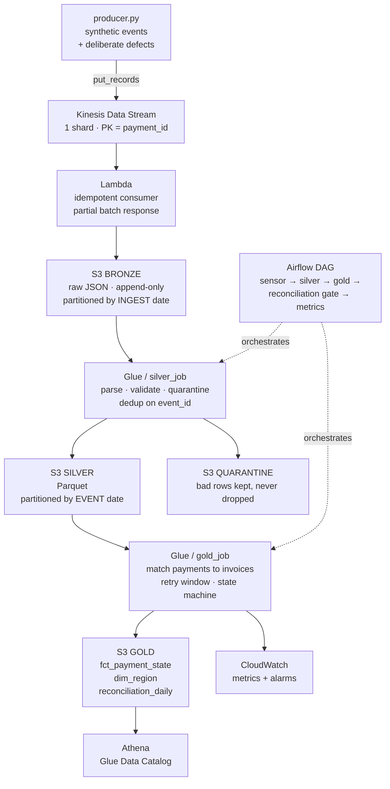

# Payment Reconciliation Lakehouse

An end-to-end AWS data platform that ingests payment and invoice events through
Kinesis, matches them under a region-configurable retry window, and produces a
daily reconciliation report that **must balance to the payment**.

Every number below was measured on a live run in `ap-southeast-2`, not estimated.

```
Kinesis -> Lambda -> S3 bronze -> silver -> gold -> Athena
9,446 events                               ALL RECONCILED
```

---

## 1. The business problem

> In cross-border payments **the money arrives before the paperwork.** Customs
> clearance lags by days, so a payment lands with no invoice to apply it against.
>
> It must be recorded immediately — it is real money and it is auditable — but it
> cannot be applied until the matching invoice appears. How long to wait before
> writing it off varies by region, because clearance times do.
>
> Finance needs one question answered defensibly every morning: **does everything
> we received equal everything we matched, are still holding, or have written off?**
> If that does not balance, the pipeline lost money somewhere.

Every design decision below traces back to a constraint in that paragraph.

---

## 2. Architecture



**The partition key changes meaning between layers, and that is deliberate.**
Bronze partitions by **ingest** date — when we received it. Silver and gold by
**event** date — when it happened. A six-day-late invoice lands in a *fresh*
ingest partition, so a forward-only read still catches it; only the write reaches
back in time. Partition bronze by event date and late arrivals land in partitions
already processed.

---

## 3. The state machine

```
PAYMENT_RECEIVED
      |
      +-- invoice found, amounts agree ------> MATCHED
      |
      +-- invoice found, amounts differ -----> AMOUNT_MISMATCH   (flagged for finance)
      |
      +-- no invoice yet
               |
               +-- within region's retry window --> PENDING
               |
               +-- past the window ---------------> EXPIRED      (exception report)
```

The retry window is **data, not code** — `conf/config.json`, per region.
US = 3 days, AE = 10. The business changes clearance windows without a deploy.

---

## 4. Results

### Correctness — the pipeline proves itself

The generator injects defects and writes an **answer key**. Every layer reconciles
against it:

| | Expected | Actual |
|---|---:|---:|
| Unique events after dedup | 9,258 | **9,258** |
| Quarantined (malformed) | 63 | **63** |
| MATCHED | 4,115 | **4,115** |
| AMOUNT_MISMATCH | 143 | **143** |
| PENDING | 487 | **487** |
| EXPIRED | 192 | **192** |

Control identity holds:
`received = matched + mismatch + pending + expired + rejected`

**Idempotency is demonstrated, not claimed.** Re-ingesting the entire stream
produces identical object counts, because the S3 key derives from batch content
rather than a timestamp.

### Cost — Athena bills on bytes scanned

| Query | Format | Scanned |
|---|---|---:|
| `count(*)` | bronze JSON | 4.2 MB |
| `count(*)` | gold Parquet | **0 B** |
| 2 columns, grouped | gold Parquet | 1.9 KB |
| `SELECT *` | gold Parquet | 274.9 KB |

`count(*)` on Parquet scans **zero bytes** — row counts live in the file footer,
so Athena answers from metadata without opening a data page. JSON has no footer
and must parse all 4.2 MB. `SELECT *` costs **144x** more than naming two columns.

Full analysis: [`notes/costs.md`](notes/costs.md)

### Resilience — a real failure, caught

Pushing 9,446 records at a 1-shard stream throttled **639 of them**. `PutRecords`
returned **HTTP 200** with `FailedRecordCount: 639`. Without resending only the
failed subset those payments would have vanished silently, and every count would
still have looked plausible. The reconciliation is what proves they arrived.

### The business answer the pipeline produced

| Region | Retry window | Write-off rate |
|---|---:|---:|
| US | 3 days | **6.5%** |
| EU | 5 days | 4.1% |
| SG | 4 days | 3.9% |
| IN | 7 days | 3.5% |
| AE | 10 days | **0.0%** |

The US writes off payments at nearly **twice** India's rate — not because US
payments are worse, but because its matching window is 3 days instead of 7.
**That is an actionable finding, and it is why the pipeline exists.**

---

## 5. Design decisions

| Decision | Chose | Over | Because | Would revisit if |
|---|---|---|---|---|
| Ingestion | Kinesis | Kafka / MSK | AWS-native, no brokers to run; 1 shard covers the 116/s peak | we needed >7d replay, Connect, or Schema Registry |
| Dedup key | `event_id` | `payment_id` | a redelivery repeats event_id; a *correction* reuses payment_id with a new event_id and must survive | — |
| Bronze format | raw JSON string | parsed columns | bronze must accept malformed input; parsing there lets one bad record break ingestion | — |
| S3 object key | hash of batch contents | timestamp / uuid | a retry overwrites an identical object instead of duplicating 100 records | — |
| Bronze partition | ingest date | event date | late events land in a fresh partition, so forward-only reads still catch them | — |
| Silver partition | event date | ingest date | queries ask "what happened on the 14th", not "what arrived on the 26th" | — |
| Bad records | quarantine table | drop | in finance you never silently discard a transaction | — |
| Retry window | config file | code | the business changes clearance windows without a deploy | — |
| `as_of` | DAG `data_interval_end` | `now()` | PENDING vs EXPIRED depends on the date asked; `now()` makes backfills rewrite history | — |
| Compute | pandas | PySpark | 9,446 records — Spark's JVM and shuffle overhead exceed the work | volume reaches ~3 GB/day, then Glue Spark |
| Serving | Athena on S3 | Redshift | spiky analyst queries, pay-per-query, no idle cluster | sustained BI concurrency needing WLM |
| Table format | Parquet | Iceberg / Delta | no concurrent writers or row-level updates when the choice was made | **already hit this** — two writers in one prefix silently doubled every count (`failures.md` #6). Iceberg's transaction log defines which files are the table; a Hive prefix does not. This is the next change. |

---

## 6. Repo layout

```
src/
  producer.py        synthetic events + injected defects + answer key
  bronze_writer.py   consumer logic; --sink local|s3
  lambda_handler.py  the deployed Kinesis -> S3 consumer
  silver_job.py      parse · validate · quarantine · dedup · repartition
  gold_job.py        match · state machine · reconciliation_daily
  athena.py          catalog registration + bytes-scanned benchmark
dags/
  payment_lakehouse_dag.py   sensor → silver → gold → gate → metrics
infra/
  deploy.sh          Kinesis + IAM + Lambda + event source mapping
  teardown.sh        deletes everything billable
sql/
  ddl.sql            explicit external table definitions
notes/
  failures.md        every incident, its diagnosis and fix
  costs.md           measured storage, scan and run costs
conf/
  config.json        region, bucket, retry windows, defect rates
```

---

## 7. How to run

```bash
python3 -m venv venv && source venv/bin/activate
pip install -r requirements.txt

# local — no AWS required
python3 src/producer.py --count 5000 --seed 42
python3 src/bronze_writer.py --batch-size 100
python3 src/silver_job.py
python3 src/gold_job.py

# on AWS
./infra/deploy.sh                                          # Kinesis + Lambda
python3 src/producer.py --count 5000 --seed 42 --sink kinesis
python3 src/silver_job.py --source s3 --sink s3
python3 src/gold_job.py   --source s3 --sink s3
python3 src/athena.py ddl
python3 src/athena.py bench

./infra/teardown.sh                                        # ALWAYS
```

`--seed` makes every run byte-identical, so a bug is the same bug twice.

---

## 8. Teardown

```bash
./infra/teardown.sh          # stream, lambda, mapping, IAM role
./infra/teardown.sh --all    # also empties and deletes the bucket
```

A Kinesis shard bills ~$0.36/day whether or not data flows through it.
`teardown.sh` was written **before** the resources it deletes.

```
Charges to date   $0.00      Credits  $120      Hard cap  $20/month
```
